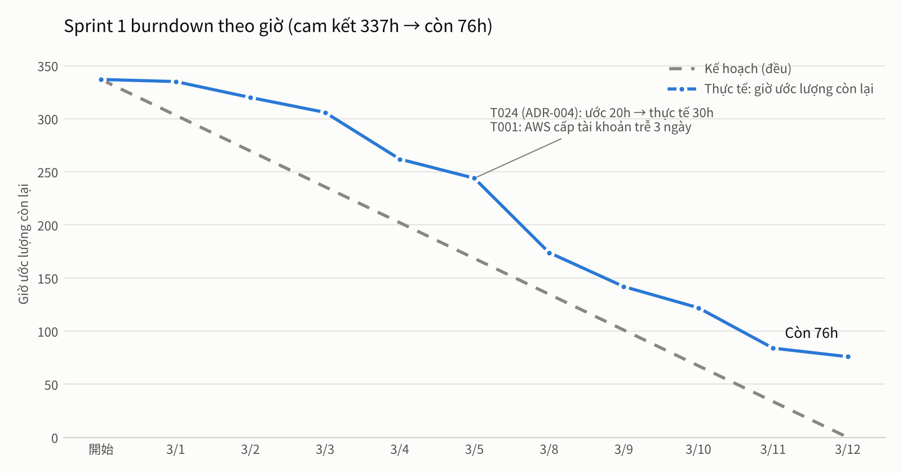

# Progress report — Sprint 1 (giả lập)

| | |
|---|---|
| Iteration trên Project | **Sprint 1** (field Iteration, 2027-03-01〜03-14) |
| Khoảng thời gian giả lập | 2027-03-01 (Thứ 2) 〜 2027-03-12 (Thứ 6), 10 ngày làm việc |
| Ngày báo cáo | 2027-03-12 |
| Ghi chú | Dữ liệu giả lập cho LAB-5. Bản tiếng Nhật gửi khách: [`reports/sprint-1-report_ja.md`](reports/sprint-1-report_ja.md) |

## 1. Trạng thái

| Trạng thái | Số issue | Tổng SWP | Giờ ước lượng | Ghi chú |
|---|---|---|---|---|
| Done | 23 | 100.0 | 261 | Gồm toàn bộ lõi tư cách (DD-01), lô, xác nhận 相対 (DD-02), công thức 奨励金 (12 test vector pass) |
| In Progress | 3 | 22.0 | 62 | T001 hạ tầng (~75%), T027 màn hình 相対, T030 danh sách giao dịch |
| Todo | 1 | 4.0 | 10 | T028 test đồng thời — chưa bắt đầu vì T025 xong ngày 3/11 |
| Blocked | 1 | 3.0 | 4 | T065 chờ khách trả lời Q-06/07/08/29/30 |
| **Tổng** | **28** | **129.0** | **337** | Capacity 380h (BE×3, FE×2, QA×1: 60h/người; BrSE 20h) |

- Mức hoàn thành: **23/28 issue**; 261/337 giờ ước lượng (77%); SWP 100/129 (78%).
- Các issue đã xong: ước lượng 261h, thực tế 283h (**+8%**). Tổng giờ thực tế của sprint: 335h.

## 2. Burndown

Burndown vẽ theo **giờ ước lượng còn lại** (giờ được ước trước khi chấm SWP; SWP của sprint ở bảng §1).

Thực tế lệch kế hoạch ở đâu:
- **3/2〜3/5 chậm 60〜76 giờ so với đường kế hoạch.** Tài khoản AWS do IT phía khách cấp trễ 3 ngày (giả định A-04 của LAB-1), nên T001 không xong. Đồng thời T024 (chuyển sang mô hình bút toán, ADR-004) mất 30h so với 20h ước lượng.
- **3/8 thu hẹp còn ~39 giờ**: T024, T019, T093, T095, T010 cùng xong trong ngày. Sau đó khoảng cách **lại tăng lên 50〜76 giờ**, vì phần việc còn lại dồn vào FE và test, mà các việc này phải chờ API.
- **Cuối sprint còn 76h.** Màn hình 相対 (T027, T030) phải chờ API T026, mà T026 xong ngày cuối → FE bị dồn việc. Bài học: đưa API contract (mock) lên trước (R-4).

## 3. Rủi ro trễ

| Rủi ro | Issue | Ảnh hưởng tới mốc nào | Hành động | Ai làm, khi nào |
|---|---|---|---|---|
| R-1 Khách chưa trả lời Q-30 (nguồn 請求額) và Q-06/07/08/29 | #81, chặn #75 → #72, #74 | Epic 完納奨励金 trễ 1 sprint → UAT奨励金 (6/21〜) bị dồn | Hỏi lại ở họp định kỳ 3/16, hạn trả lời 3/19; nếu không có trả lời thì làm theo giả định A4-04 dưới dạng cấu hình có thể đổi | BrSE-An, 3/16〜3/19 |
| R-2 AWS cấp tài khoản trễ | #17, kéo theo #18 | Có môi trường stg để test tích hợp trễ khoảng 1 tuần | Dựng trước ở tài khoản dev của đội (không dùng dữ liệu thật), chuyển sang khi khách cấp | BE-Hùng, xong 3/17 |
| R-3 Refactor ADR-004 lớn hơn ước lượng | #67 (đã tăng 5→8 size, 18→28h), #63, #71 | Sprint 2 có thể vượt cam kết | Ước lượng lại trước sprint planning; Sprint 2 cam kết ~70% capacity | BE-Nam, 3/15 |
| R-4 FE chờ API | #43, #46, #48 | Màn hình hoàn thành cuối sprint, không kịp test | Chốt API contract + mock ở ngày 1 của sprint | Tech lead, mỗi sprint planning |
| R-5 Tổng ước lượng backlog chỉ bằng 22% LAB-1 | Toàn backlog | Nguy cơ hiểu sai năng lực → cam kết quá mức các sprint sau | Không dùng để báo giá lại; đánh giá lại ở Sprint 3 khi đủ spec | PM, Sprint 3 review |
