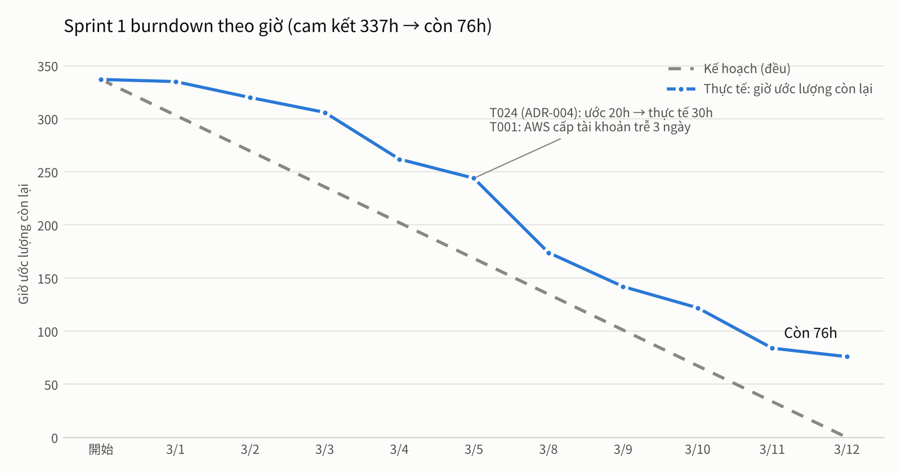

# 株式会社 桜水産市場 御中　業務支援システム開発　スプリント報告書

| 項目 | 内容 |
|---|---|
| 対象 | Sprint 1（2027年3月1日〜3月12日、稼働10日） |
| 報告日 | 2027年3月12日（金） |
| 作成 | 〔提案会社名〕 ブリッジSE |
| 進捗管理 | GitHub Project「桜水産市場 業務支援システム — Delivery (LAB-5)」・Iteration「Sprint 1」 |

> ※ 本報告書は研修演習（LAB-5）用の**模擬スプリント**です。日付・実績値・担当者は架空であり、実プロジェクトの数値ではありません。

## 1. サマリー

| 指標 | 値 | 評価 |
|---|---|---|
| 計画 | 28件・見積 337時間 | — |
| 完了 | **23件・見積 261時間分（達成率 77%）** | 🟡 要注意 |
| 持越し | 5件・76時間分（進行中3、未着手1、ブロック1） | Sprint 2 に繰越し |
| 工数（完了分） | 見積 261h → 実績 283h（+8%） | 許容範囲 |
| チーム稼働 | 実績 335h／確保 380h（88%） | — |
| 本番稼働（2027/8/9）への影響 | **現時点で影響なし**。ただし下記リスク R-1 の回答期限 3/19 を過ぎると、完納奨励金の開発開始が1スプリント遅れます | 🟡 |

**今スプリントの成果：** 相対取引（主フロー）の「資格確認・数量引当・確定」を1トランザクションで行う業務関数と API が完成しました。資格切れの買手（例：N03）との取引は確定時点で拒否され、取引データは作成されません（FR-AITAI-02）。完納奨励金の計算式は、テストベクター12件（INC-EDGE-01〜03 を含む）をすべて満たしています。

## 2. バーンダウン

前半（3/2〜3/5）は計画線より 60〜76 時間遅れました。主な原因は、確定後修正（赤黒）を「同一取引番号の明細」として持つ設計（ADR-004）に合わせた既存データ移行が、見積 20h に対し実績 30h かかったことです。3/8 に移行が完了して差は約 39 時間まで縮まりましたが、その後は画面・テスト作業が API 完成待ちとなり、最終的に 76 時間が残りました。

## 3. 機能別の進捗

| 区分 | 計画（見積時間） | 完了（見積時間） | 状況 |
|---|---|---|---|
| 基盤（クラウド環境・共通画面部品） | 84 | 52 | 環境構築（T001）は進行中 — R-2 参照 |
| 認証・権限 | 24 | 24 | 8ロールの権限マトリクス、アカウント管理画面 完了 |
| 参加者・資格（許可／承認） | 22 | 22 | 資格判定関数 完了。許可・承認・市場登録・取引地点登録を区分ごとに判定 |
| ロット | 38 | 38 | ロット採番の重複防止、数量台帳、タブレット受付画面 完了 |
| 相対取引 | 100 | 60 | 業務関数・API 完了。入力画面・一覧画面は Sprint 2 前半に完了予定 |
| **完納奨励金** | 30 | 26 | 計算式・支払期日・料率版の時点解決 完了。**仕様確認（Q-06/07/08/29/30）が未回答** — R-1 |
| マスタ | 8 | 8 | 品目・荷主 完了 |
| 品質・確認事項 | 31 | 31 | テスト計画、確認事項 Q-26〜Q-33 送付済み |

## 4. 持越し項目

| ID | 内容 | 見積(h) | 状態 | 完了見込み | 理由 |
|---|---|---|---|---|---|
| T001 | 本番相当のクラウド環境構築（東京・マルチAZ） | 32 | 進行中（約75%） | 3/17 | アカウント発行待ち（R-2） |
| T027 | 相対取引 入力・確定画面（キーボード操作） | 18 | 進行中 | 3/16 | API 完成（3/12）待ちのため着手が遅れた |
| T030 | 取引一覧・詳細、取引票 | 12 | 進行中 | 3/18 | 同上 |
| T028 | 同時確定の負荷テスト（過剰販売が起きないこと） | 10 | 未着手 | 3/19 | 業務関数の完成が 3/11 となったため |
| T065 | 完納奨励金の仕様確認とテストベクターのご確認 | 4 | **ブロック** | 貴社ご回答後 | R-1 |

## 5. リスクと対策

| No | リスク | 影響 | 可能性 | 対策 | 担当 | 期限 |
|---|---|---|---|---|---|---|
| **R-1** | 完納奨励金の仕様（請求額の取得元 Q-30、税係数 Q-06、適格金額 Q-07、支払期日 Q-08、対象者 Q-29）が未確定 | 高：Sprint 2 予定の入金データ取込（T059）に着手できない。遅延すると奨励金機能全体（15件・140時間）が1スプリント後ろ倒し | 中 | 回答がない場合は提案時の仮定（A4-04 等）で設定値として実装し、後から切替可能にする。3/16 定例会で回答期限 3/19 をお願いする | ブリッジSE | 3/19 |
| **R-2** | クラウド環境（AWS アカウント・権限）の発行が予定より3営業日遅れた（前提条件 A-04） | 中：CI/CD（T002）の開始が遅れ、結合環境での確認が Sprint 2 後半にずれる | 発生済み | 当社検証用アカウントで先行構築（実データは扱わない）し、発行後に移設。残作業は 3/17 完了見込み | テックリード | 3/17 |
| R-3 | 赤黒明細化（ADR-004）の影響範囲が見積より大きい | 中：Sprint 2 の関連作業（T047, T051, T055）も同様に超過する可能性 | 中 | T051 を 18→28 時間に再見積済み。Sprint 2 の計画量を確保時間の約70%に抑える | テックリード | 3/15 |
| R-4 | 画面担当が API 完成を待つ形になった | 低〜中 | 中 | Sprint 2 から API 仕様（モック）を先に確定し、画面と API を並行開発する | テックリード | 3/15 |

## 6. 貴社へのお願い事項

| No | 内容 | ご回答期限 |
|---|---|---|
| 1 | 確認事項 **Q-30**（請求額は会計システムの売掛データから取得してよいか）ほか Q-06・Q-07・Q-08・Q-29 へのご回答 | **3/19（金）** |
| 2 | 確認事項 **Q-26**（赤黒を同一取引番号の明細として管理する方針で会計連携上問題ないか） | 3/26（金） |
| 3 | 本番 AWS アカウントの管理者権限付与（IT部門様） | 3/16（月） |

## 7. 次スプリント（Sprint 2：3/15〜3/26）の計画

- 計画量：持越し 76時間 ＋ 新規 約190時間 ＝ **約270時間**（確保 380 時間の約70%。当初案 325 時間から縮小）
- 主な目標：相対取引の画面完成と負荷テスト、せり結果の入力・確認（入力者≠確認者）、引渡し記録（分割・例外）、確定後修正（赤黒）の業務関数、料率版の承認（年4回上限チェック）
- 完納奨励金：R-1 のご回答状況により「入金データ取込」を着手または後ろ倒し（3/19 に判断）

以上
